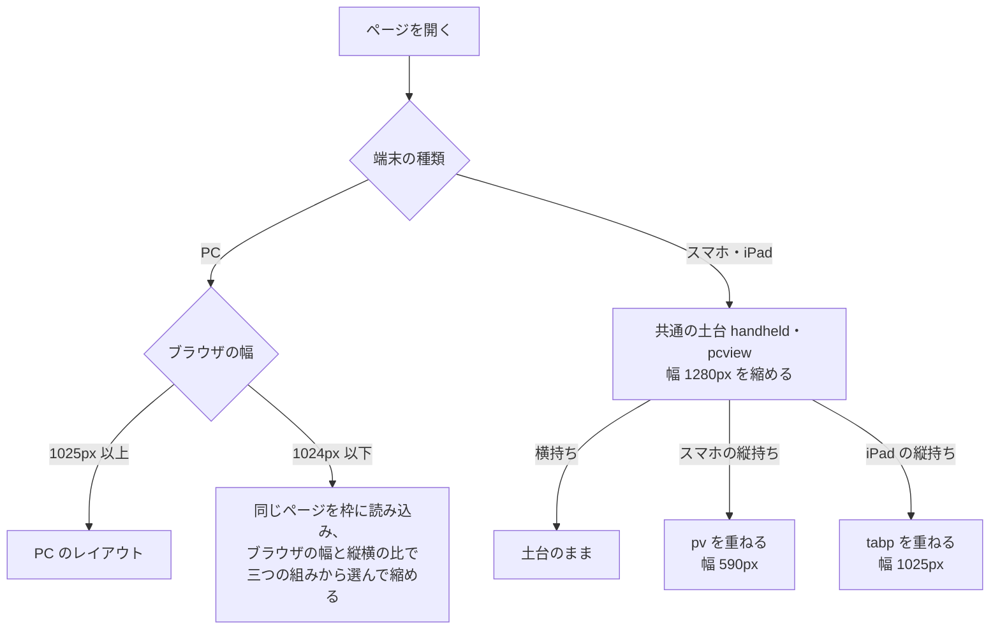
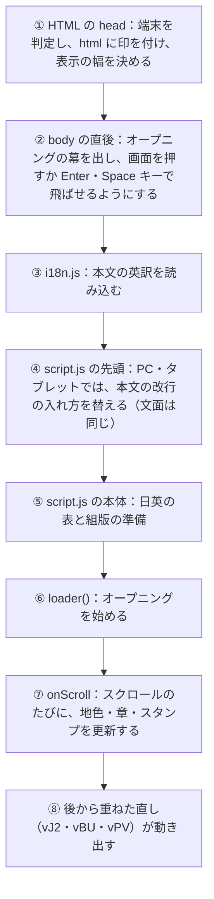

# ジブンのゼンブを。

**サイト：https://jibun-no-zenbu.pages.dev**

小坂脩蔵の自己紹介サイト「ジブンのゼンブを。」の CSS・JavaScript を公開しています。

サイトは、サイバーエージェントの選考に向けて作りました。私が生まれてから今までを 7 つのチェックポイントに分けて紹介し、画面は私の研究から得たグリッドで組んでいます。

私にはコーディングや Web 制作の知識が、まったくと言っていいほどありませんでした。それでも AI を活用して作れば、ここまでのものを形にできる。サイバーエージェントの「自分が好きなものを魅力的に伝える」という課題に取り組むなかで、そのことを発見できました。このような機会をいただき、ありがとうございます。

このリポジトリにあるのは CSS と JavaScript だけで、ファイルを開いてもサイトは表示されません（くわしくは「このリポジトリにあるもの」）。コードを読むときは、先に「画面の並び」と「ページが動く流れ」を見ておくと、全体を追いやすくなります。

## 工夫したこと

- **研究から得たグリッドで画面を組み、その線を見せる。** 「グリッドを表示」で線を重ねて見られ、ゲーム「絵を、測る。」では、自分で引いた線から得たグリッドと見比べられます。
- **端末と向きに合わせて組み替える。** スマホとタブレットは縦持ち・横持ちの両方に合わせて組み、向きを変えても、読んでいた箇所から続けて読めます。
- **AI と案を出し合って組み上げる。** ノーコードで Web サイトを作れる STUDIO でプロトタイプ兼ワイヤーフレームを作り、それをもとに AI と約 1200 回のやり取りを重ねて形にしました。

## ご覧になるときに

- PC・スマホ・タブレットでご覧いただけます。スマホとタブレットは、縦持ち・横持ちの両方に対応しています。ゲーム「絵を、測る。」だけは横長の画面に合わせて作っているので、スマホを縦にしたまま開くと、横に持ち替える案内が出ます。
- オープニングは 45 秒ほどです。画面の下の線（PC と横持ちでは朱、縦持ちでは生成り）が再生の進み具合を示します。オープニング中は、画面のどこを押しても TOP へ進めます。
- 演出の動きを抑えて見たいときは、URL の末尾に `?reduce=1` を付けてください。

## 骨格は、研究から得たグリッドです

桜を描いた日本の絵画 3 点に、絵の中の主なまとまりがどこで始まり、どこに重心があるかといった線を引き、その位置を平均しました。この平均グリッドを、本文・写真・年号の配置の基準にしています。

線で分けた各段の幅の比（区間比率）は、次のとおりです。どちらも合計 100% です。

- 左から右へ：12 : 16 : 30 : 25 : 17
- 上から下へ：14 : 18 : 39 : 29

`style.css` では、この比を左端・上端から足し上げた、線の位置で持っています。

| 線 | 位置（左端・上端から足し上げ） | `style.css` | 研究での名前（機能名称） |
|---|---|---|---|
| 縦 1 | 左から 12% | `--x1` | 主塊開始線 |
| 縦 2 | 左から 28%（12＋16） | `--x2` | 密度転換線 |
| 縦 3 | 左から 58%（28＋30） | `--x3` | 主塊重心線 |
| 縦 4 | 左から 83%（58＋25）。右端まで残り 17% | `--x4` | 副次要素境界線 |
| 横 1 | 上から 14% | `--y1` | 主塊開始線 |
| 横 2 | 上から 32%（14＋18） | `--y2` | 主塊重心線 |
| 横 3 | 上から 71%（32＋39）。下端まで残り 29% | `--y3` | 密度転換線 |

縦 2・縦 4・横 3 は、3 点のうち 2 点で見られた線で、研究では補助の線として扱っています。値は `style.css` の `:root` にあります。横の線は画面の高さに対する割合です。サイトの「グリッドを表示」を押すと、画面にこの線が重なります。比率は端末や向きが変わっても同じです。

ゲーム「絵を、測る。」では、日本の絵（12 点）か西洋の絵（7 点）を選ぶと、そこから無作為に 3 枚が出ます。1 枚ごとに、主塊開始線と主塊重心線を縦と横に 1 本ずつ、合わせて 4 本引きます。3 枚を引き終えると、同じ名前・同じ向きの線どうしで位置を平均し、サイトのグリッドと重ねて見比べられます。

## 画面の並び

縦にスクロールして読み進めます。この説明では、HTML の `<section>` ひとつを「画面」と呼びます。どの画面も、`id` と、地色を決める `data-scene` を持っています。地色は、ブラウザの表示の上から 7 割ほど（下から 28%）の高さに掛かった画面の `data-scene` の色に替わります（`script.js` の `sceneUpdate`）。年と地名は、表示の真ん中に来た画面で替わります。

| 順 | 画面 | `id` | 地色（`data-scene`） | 組み |
|---|---|---|---|---|
| 1 | TOP | `top` | 生成り（`paper`） | 流れる |
| 2 | MESSAGE | `message` | 朱（`shu`） | 留まる |
| 3 | チェックポイントの一覧 | `contents` | 生成り | 流れる |
| 4 | ABOUT ME | `ch1pin` | 生成り | 留まる |
| 5 | 映像「では、最初のチェックポイントへ。」 | `bridge` | 生成り | 流れる |
| 6 | CHECKPOINT 01 | `ch1` | 生成り | 流れる |
| 7 | CHECKPOINT 02 | `ch2` | 夜（`night`） | 流れる |
| 8 | CHECKPOINT 03 | `ch3` | 生成り | 流れる |
| 9 | CHECKPOINT 04 | `ch4` | 生成り | 流れる |
| 10 | CHECKPOINT 05 | `ch5pin`・`ch5` | 墨（`ink`） | 留まる → 流れる |
| 11 | CHECKPOINT 05 の続き（地図から海外へ） | `ch5map`・`ch5trip`・`ch5intern` | 紫（`asia`） | 留まる → 流れる |
| 12 | CHECKPOINT 06（研究） | `ch6` | 生成り | 流れる（中に留まる所あり） |
| 13 | CHECKPOINT 07 | `ch7` | 朱 | 流れる |
| 14 | MAKING | `works` | 墨 | 流れる |
| 15 | MAKING WITH AI | `ch7b` | 青（`code`） | 流れる（中に留まる所あり） |
| 16 | NEXT STAGE | `ch7c` | 黄緑（`green`） | 流れる（中に留まる所あり） |
| 17 | PROFILE / CONTACT | `contact` | 墨 | 流れる |

「流れる」は普通にスクロールする画面（`.sp`）、「留まる」はスクロールしても、しばらくその場に留まる画面（`.pin`）です。CHECKPOINT 06 の研究の手順（`#seq`）と、MAKING WITH AI・NEXT STAGE の本文（`.solopin`）は、`.sp` の画面の中で一部だけが留まります。地色の値は `style.css` の `:root` と `body[data-scene]`、`script.js` の `j1Scn` にあります。`script.js` の `CHAP_OF` は、画面を章の番号 0〜9 に振り分けています（TOP・MESSAGE・一覧が 0、ABOUT ME・映像「では、最初のチェックポイントへ。」・CHECKPOINT 01 が 1、CHECKPOINT 02〜07 が 2〜7、MAKING から NEXT STAGE までが 8、CONTACT が 9）。章へ飛ぶときの「5 秒スキップ／巻き戻し」の表示で、飛ぶ章の数を数えるのに使います。

## 端末と向きに合わせたレイアウト

グリッドの比率を保ったまま、縦持ちでも本文を読みやすくするため、PC で作ったレイアウトを土台に、端末と向きごとに組み方を分けました。スマホとタブレットでは、組み方を画面の幅ではなく端末の種類で選びます。幅だけで切り替えると、列の比率が崩れるためです。

この判定は、HTML の先頭（head）にある小さなスクリプトが行います。このスクリプトはここに入れていません。判定の結果は、`html` 要素に付く印（クラス）と、表示の幅に表れます。`style.css` と `script.js` は、この印を見て組み方を変えます。

| 見ている画面 | `html` の印 | 表示の幅 | 表示の工夫 |
|---|---|---|---|
| PC | なし | ブラウザの幅 | PC のレイアウト |
| スマホ・iPad（共通の土台） | `handheld`・`pcview`、`phone` か `tablet` | 1280px | 幅 1280px のレイアウトを、画面に合わせて縮める。横持ちはこのまま表示する |
| スマホの縦持ち | 土台に `pv` を重ねる | 590px | 縦持ち専用のレイアウト。本文は 22px、グリッドの比率はそのまま |
| iPad の縦持ち | 土台に `tabp` を重ねる | 1025px | PC のレイアウトを縮め、字の大きさは横持ちにそろえる |

スマホでは `window.__pvOn`、iPad などのタブレットでは `window.__tabS` という目印も立てます。どちらも向きにかかわらず立ち、いま縦持ちかどうかは `html.pv`・`html.tabp` で見ます。どちらも head のスクリプトが立てるので、`script.js` で検索すると、使っている所だけが見つかります。

PC でブラウザの幅を 1024px 以下に狭めたときは、同じページを枠の中に読み込みます。ブラウザの幅と縦横の比から、スマホの縦持ち（幅 590px）・iPad の縦持ち（幅 1025px）・PC（幅 1025px）の三つの組みから選び、ブラウザに収まるように縮めます（`script.js` の `__pcfOn`）。

向きを変えたときは、ページを読み直さずにその場で組み替え、読んでいた箇所へ戻します。スマホは `inplace`・`__pvAnchor`、iPad は `__tabKeep`・`__tabAnchor` が受け持ちます。スマホで、組み替えてから 1 秒たっても表示の幅や拡大率が合わないときは、ページを読み直す方法に切り替えます。iPhone と iPad の Safari では、画面の上部・下部の帯の色も、表示している画面の地色に合わせて変えます。

## ページが動く流れ

①〜③ はこのリポジトリに入っていません。`script.js` は `defer` で読み込むので、HTML を読み終えてから動きます。地色・章・留まる画面・スタンプなどの主な更新は `onScroll` の中で順に呼ばれ、後から足した機能の多くは、それぞれ別にスクロールを受けています。

どちらのファイルも、作った順に書き足しています。`script.js` は、全体の 7 割ほどを占めるひとつの大きなまとまり（オープニング、地色と章、スタンプラリー、メニュー、日英の切り替え、ゲームなど）のあとに、後から重ねた直しのまとまり（`vJ2`・`vBU`、スマホとタブレットの縦持ちの `vPV`）が続きます。`style.css` も、画面ごとの基本の指定のあとに、ゲーム（`.gm`）、後期の直し（`J1`・`vJ2`・`vBU`）、スマホの縦持ち（主に `html.pv` の下）、iPad の縦持ち（`html.tabp`）が続き、最後に縦持ちまわりの細かな直しが並んでいます。後ろの方のまとまりは、前の方の機能の見え方を調整しています。`__retint`・`__hkUpdate`・`__hkBuild`・`__buLang` のように、後ろのまとまりで中身が書き換えられる関数（ひとまとまりの処理）もあります。最初に出てくる所だけを読むと、いまの動きと違うことがあります。

## 作り方

制作は、STUDIO でプロトタイプ兼ワイヤーフレームを作るところから始めました（プロトタイプ：[shuzokosakaportfolio.studio.site](https://shuzokosakaportfolio.studio.site/)）。それをもとに AI と HTML を作り、そのあと Claude Code に移り、そこで約 1200 回のやり取りを重ね、案を出し合いながら試しては直してきました。写真や手書きの文字などの素材を私が渡し、AI に組み込んでもらう場面もありました。やり取りを重ねるうちに、AI は私の傾向や好みをつかみ、自分から次の案を出してくれるようになりました。AI にこれほど提案する力と自走する力があるのかと、制作を通して実感しました。

- **色**：生成り `#F2F2EE`・墨 `#1C1B19`・朱 `#E84518` が基本です。画面ごとの地色は 7 つ（生成り・朱・墨・夜・紫・青・黄緑）で替えていて、墨の画面の地は、文字の墨より少し深い `#15151A` です。下地や幕には、ほとんど同じ生成りの `#F2F1EC` も使っています。
- **書体**：Google Fonts の Zen Old Mincho・IBM Plex Sans JP・IBM Plex Mono・Marcellus を使っています。英語の見出しは、Optima が入っている端末では Optima、ない端末では Marcellus で表示します。
- **映像**：オープニングと「では、最初のチェックポイントへ。」の映像は、幼い頃から今までの写真と動画を OpenCV（画像を処理するためのライブラリ）で墨の濃淡に落とし、動きを追って朱と生成りの線を重ねたものです。線は SVG で描き、ffmpeg（動画を変換する道具）で書き出しました。「では、最初のチェックポイントへ。」は、縦持ち用に、縦の画面いっぱいに表示する映像も別に用意しています。
- **スケッチ**：Python で線を一本ずつ生成した SVG です。線ごとに描き始める時刻と描く時間を決め、下描きは速く、丸はゆっくり描きます。
- **手書き**：「デザインで人を楽しませたい」は、私の手書き文字を、形を変えずに画ごとに分け、書き順どおりに一画ずつ現れるようにしました。一画ずつ書き進む動く画像（アニメーション WebP）として書き出してあり、`script.js` は再生を始めて、書き終わるのを待ってから次の一文を出します。
- **外部のライブラリ**：CONTACT の「サプライズ」のうち、落ちる・浮く・飛び散る 3 つの演出の物理演算に matter.js（MIT）を使っています。

手元では本文と CSS・JavaScript を Python で 1 枚の HTML に組み上げ、公開するときに CSS・JavaScript を切り出し、画像をファイルに書き出しています。公開先は Cloudflare Pages（Web サイトを配信するサービス）です。

## 確かめ方

- **Playwright（Chromium と WebKit）**：ブラウザを自動で動かして画面を撮る道具です。PC・タブレット・スマホの画面を、縦持ちと横持ち、日本語と英語で開き、実行時のエラーや、画像・映像の読み込みの失敗がないかを確かめています。直す前と後の画面を撮って比べ、意図しない見た目の変化がないかも見ます。
- **iOS シミュレータ**：iPhone と iPad の Safari で、見え方と、縦持ち・横持ちを切り替えたときの動き（読んでいた位置に戻るか、画面の上部・下部の帯の色）を確かめています。Playwright だけでは、iOS の向きの切り替えに伴う動きを十分に確認できないためです。
- **読み込みの重さ**：処理速度と通信速度を落とした条件で、読み込み画面の動きが止まってしまう時間や、読み込み率の表示が動き出すまでの時間を測りました。

## このリポジトリにあるもの

ここに置いているのは、この説明（`README.md`）と、サイトの見た目を決める `style.css`、動きを決める `script.js` の 3 つだけです。

いまのファイルには、ページの骨組みにあたる HTML、写真や映像、研究資料、本文、本文の英訳は入れていません。私自身の写真や、選考のために書いた文章など、広く公開することを前提にしていない内容を含むためです（サイトも、検索結果に出ないように設定しています）。`script.js` に入っている文章は、ボタンや写真の説明文などの短い文言と、ゲーム「絵を、測る。」の文章（遊び方の案内、Q&A、19 枚の絵の解説）、それぞれの英訳です。

そのため、この 3 つのファイルだけを開いても、サイトは表示されません。サイトそのものは上のリンクからご覧いただき、ここでは、サイトの見た目や動きを指定するコードをご覧いただけます。

コードの中には、次のような印があります。

- `{{BOARD_01}}` や `{{INKMASK}}` のような波括弧の印は、組み上げのときに画像の置き場所へ差し替える差し込み口です。
- `assets/` で始まる場所（映像・画像）と matter.js は、ここには入れていません。
- PC・タブレットで使う本文（文面はスマホと同じで、改行の入れ方だけが違います）と、映像を再生できる形に戻すための鍵は、いまのファイルでは中身を空にしています。日英の対照表からも、本文の段落にあたる項目（16 件）を省いています。空に見える所や短く見える表があるのは、そのためです。
- URL の末尾に付ける切り替え（`?pv99=0` や `?pcfm=pv` など）が多く残っています。多くは見比べと確かめのためのものです。`?pcf=` や `?pvr=` のように、サイトが自分で付けるものもあります。

公開しているサイトが読み込む `assets/js/site.js` も中身は同じですが、行番号は合いません。コメントが違うほか、ここで空にした値と差し込み口に実際の値が入り、末尾に公開用の数行が足してあるためです。関数の名前で探してください。

## コードを読むための検索語

ファイルを開き、ブラウザの検索（Ctrl＋F／⌘＋F）で探してください。各ファイルの冒頭にも、探すときの語の短い一覧があります（この表とは載っている語が違います）。冒頭で見つかったときは、もう一度検索すると、コードの本体へ進めます。

| 画面と操作 | ファイル | 検索語 |
|---|---|---|
| ページが動き出すところ／スクロールのたびの更新 | script.js | `loader()`／`function onScroll` |
| 平均グリッドの値／「グリッドを表示」 | style.css／script.js | `--x1`・`html.grid`／`gridbtn` |
| オープニング（読み込み → 幕 → 映像 → 文字の打ち込み → TOP） | script.js／style.css | `function loader`／`.ld{` |
| 縦持ちではオープニングを三段（iPad は二段）に分けて表示し、線で再生の進み具合を示す | script.js／style.css | `ld-tiles`・`ld-prog` |
| 画面ごとの地色の切り替え | script.js／style.css | `function sceneUpdate`・`j1Scn`／`data-scene` |
| 画面と章の番号の対応 | script.js | `var CHAP_OF` |
| スマホ・iPad の共通の土台（幅 1280px を縮める） | style.css | `html.pcview` |
| スマホの縦持ち（幅 590px の専用レイアウト） | script.js／style.css | `__pvOn`／`html.pv` |
| iPad の縦持ち（幅 1025px を縮める） | script.js／style.css | `__tabS`／`html.tabp` |
| PC でブラウザの幅を狭めたとき（同じページを枠の中に読み込んで縮める） | script.js／style.css | `__pcfOn`／`#pcfit` |
| スマホで向きを変えたときにその場で組み替え、読んでいた箇所へ戻す | script.js | `inplace`・`__pvAnchor` |
| iPad で向きを変えたとき | script.js | `__tabKeep`・`__tabAnchor` |
| Safari の画面上部・下部の帯の色を画面の地色に合わせる | script.js／style.css | `__retint`／`#pvbandT` |
| 読んでいた位置を保つ日英の切り替え | script.js | `function setLang` |
| スマホでは MESSAGE・AI・NEXT STAGE の本文をページに分け、めくって読めるようにする | script.js／style.css | `__vkPack`／`html.vk` |
| 見出しの混植（漢字はゴシック、かなは明朝） | script.js | `ttlClasses` |
| 写真の説明文を文節の切れ目で改行する | script.js | `__capPh` |
| 背景のスケッチを、手で描くような速さで一本ずつ描く | style.css | `.illo` |
| チェックポイントのスタンプラリー（経路を塗り、朱の判を押す） | script.js | `function srBuild`・`srUpdate` |
| 研究資料を 2 列に並べ、サイト内で読めるようにする | script.js／style.css | `railBuild`／`.rcol` |
| ゲーム「絵を、測る。」（19 枚の絵、線の平均と比較） | script.js／style.css | `var BOARDS`・`avgRender`／`.gm{` |
| CONTACT の「サプライズ」（文字やページの演出 7 種） | script.js | `SUR_KINDS` |

## コメントについて

コメントには、見え方や操作で気になったことと、その直し方を書いています。先頭の `v861`・`vJ2`・`vBU-13-10`・`vPV 99 r7` などは直した回の印で、読む順番を示すものではありません（`vBU` は全体を磨き込んだ回、`vPV` はスマホとタブレットの縦持ちに対応させた回とその後の直し）。`J1` は処理を軽くした回（読み込み中やスクロール中の重さを減らした直し）の印です。`IM-04` や `sim2-01` のような英字と数字の札は、直した項目の番号なので、読み飛ばして構いません。古い回のコメントは英語、新しい回は日本語で書いています。コメントに出てくる `.py`（`illo.py`・`make_dist.py`）は、手元で素材を作ったり、公開用に書き出したりするための道具で、ここには入れていません。
